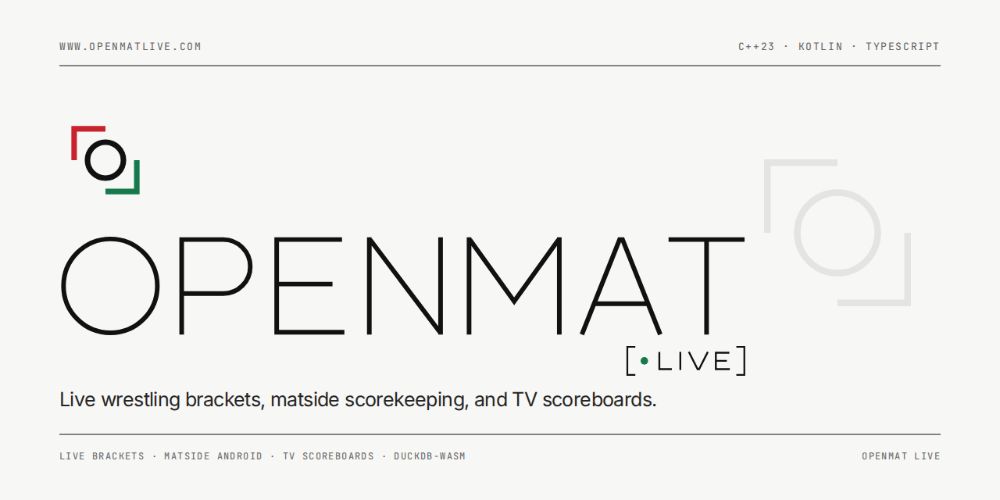

  

<h1 align="center">OpenMat Live</h1>

  <strong>Offline-first folkstyle wrestling tournament software built for real high school gyms.</strong> 
  Live brackets, mat assignments, QR weigh-ins, 1080p HDMI TV scoreboards, and matside scoring that keeps running when gym Wi-Fi drops.

  <a href="https://openmatlive.com/?utm_source=github&utm_medium=readme&utm_campaign=openmat_repo"><strong>Website</strong></a> ·
  <a href="https://demo.openmatlive.com/?utm_source=github&utm_medium=readme&utm_campaign=openmat_repo"><strong>Live Public Sandbox (No Login)</strong></a> ·
  <a href="https://openmatlive.com/for-coaches/?utm_source=github&utm_medium=readme&utm_campaign=openmat_repo"><strong>For Coaches</strong></a> ·
  <a href="https://openmatlive.com/downloads/?utm_source=github&utm_medium=readme&utm_campaign=openmat_repo"><strong>Android App</strong></a> ·
  <a href="https://www.youtube.com/@openmatlive"><strong>YouTube Films</strong></a>

---

## Try It Live (Zero Login Required)

| Surface | Live Demo Link | Purpose |
| --- | --- | --- |
| **Players & Spectators** | [demo.openmatlive.com](https://demo.openmatlive.com/?utm_source=github&utm_medium=readme&utm_campaign=openmat_repo) | Follow wrestlers, live mats, on-deck calls, brackets, and team standings from any phone browser. |
| **Officials Desk** | [demo.openmatlive.com/officials/](https://demo.openmatlive.com/officials/?utm_source=github&utm_medium=readme&utm_campaign=openmat_repo) | Roster import, QR check-in, private weigh-ins, automatic brackets, and mat queue dispatch. |
| **Matside Scorekeeper & TV** | [demo.openmatlive.com/scorekeeper/](https://demo.openmatlive.com/scorekeeper/?utm_source=github&utm_medium=readme&utm_campaign=openmat_repo) | Full NFHS 2026–27 folkstyle scoring with Chrome Presentation 1080p HDMI TV scoreboard. |
| **Wrestler Self-Registration** | [demo.openmatlive.com/register/](https://demo.openmatlive.com/register/?utm_source=github&utm_medium=readme&utm_campaign=openmat_repo) | Pre-weigh-in mobile form with offline scannable QR pass. |
| **Host a Free Beta Event** | [openmatlive.com/setup/](https://openmatlive.com/setup/?utm_source=github&utm_medium=readme&utm_campaign=openmat_repo) | Launch an isolated tournament link (`https://<event>.openmatlive.com`) free during beta (1–20 mats). |

## Why OpenMat Live?

- **Offline-First at Every Mat Table:** Matside scorekeepers persist every score, clock tick, and NFHS maneuver locally (IndexedDB/OPFS + signed journals) and sync automatically when gym Wi-Fi returns.
- **Zero Accounts & Zero Ads for Families:** Parents open one link or scan one gym QR code to track their wrestler without downloading an app or creating an account.
- **1080p HDMI TV Scoreboards Without Extra Hardware:** Plug an HDMI or USB-C cable from any laptop, Chromebook, or Android device directly into a gym TV.
- **NFHS 2026–27 Folkstyle Rules Engine:** 3-point takedowns, 2/3/4-point nearfall, stalling progression, blood/injury timers, overtime/tiebreakers, 30-minute rest locks, and dual meet tiebreakers.
- **Cryptographic Local-First Architecture:** RFC 8949 deterministic CBOR wire protocol, Ed25519 domain-separated signatures, DuckDB-Wasm OPFS local database, Light DOM Lit web components, and WebRTC P2P overlay.

## Watch OpenMat in Action

- [Why We Built OpenMat — Wrestling Tournament Software From Every Angle (1:44)](https://www.youtube.com/watch?v=Wio7fF6_BiI)
- [Don't Miss The Whistle (30s)](https://www.youtube.com/watch?v=QoaKQNepyO8)
- [Inside The Circle (30s)](https://www.youtube.com/watch?v=vbBv4X31z7A)
- [Ten Seconds (30s)](https://www.youtube.com/watch?v=8pUN6MfAK6w)

## Guides & References

- [Free Wrestling Tournament Software for Coaches](https://openmatlive.com/for-coaches/?utm_source=github&utm_medium=readme&utm_campaign=openmat_repo)
- [Matside Scorekeeper & HDMI TV Scoreboard Guide](https://openmatlive.com/scoreboard/?utm_source=github&utm_medium=readme&utm_campaign=openmat_repo)
- [NFHS Folkstyle Wrestling Scoring & Tournament Rules](https://openmatlive.com/nfhs-rules/?utm_source=github&utm_medium=readme&utm_campaign=openmat_repo)
- [AI Agent Integration Guide (`llms.txt`)](https://openmatlive.com/llms.txt)
- [Android Matside APK Downloads](https://openmatlive.com/downloads/?utm_source=github&utm_medium=readme&utm_campaign=openmat_repo)

---

Built by wrestling parents, former high school wrestlers, tournament hosts, and software engineers.  
Questions or feedback: [support@openmatlive.com](mailto:support@openmatlive.com)
